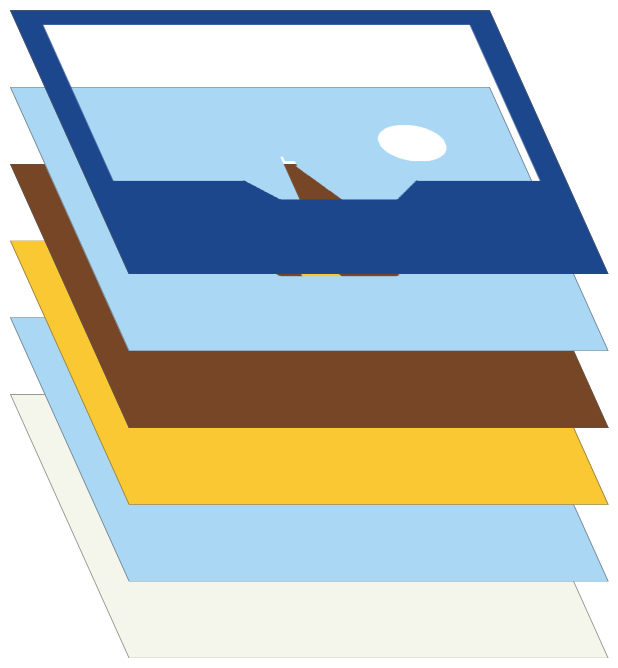
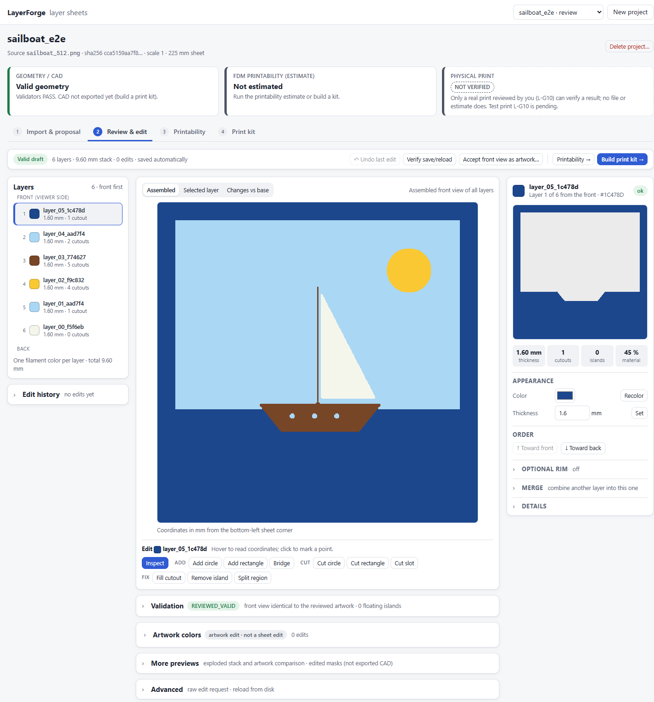
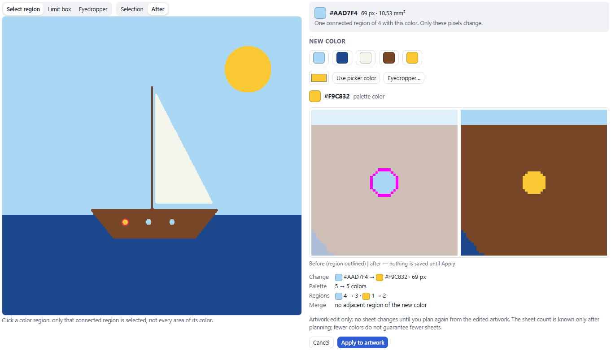
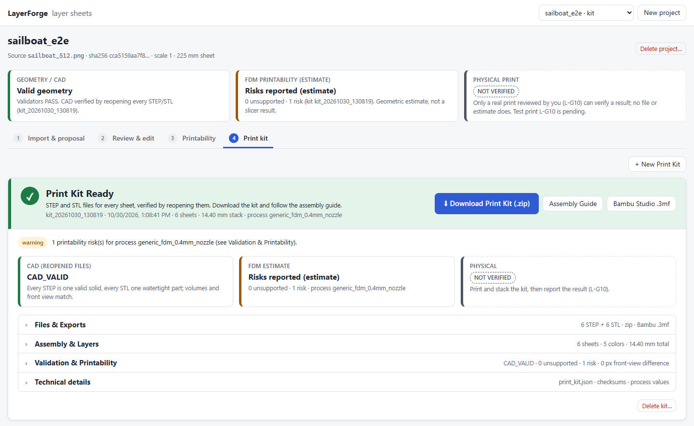

# LayerForge

**Turn a flat-color illustration into a stack of 3D-printable layer sheets that rebuild the artwork when they are stacked.**

LayerForge takes a 2D illustration (PNG/JPEG), works out how to split it into ordered physical sheets (one filament color per sheet, with cutouts that reveal the sheets behind them), and exports real CAD for each sheet: STEP solids and STL meshes, ready for a slicer. Seen from the front, the assembled stack reproduces the artwork pixel for pixel. Every sheet is also checked to be printable as one connected piece.

<p align="center">
  
</p>
<p align="center"></p>
<p align="center"><sub>Top: the six sheets planned for a test illustration, back to front. Bottom: the target artwork, the front view rendered from the <b>exported and reopened STL files</b>, and the mismatch map: 0 pixels differ.</sub></p>

---

## Why this is harder than it looks

A stack of colored sheets is a constrained physical object, not an image filter:

- **Occlusion is one-directional.** A sheet can only show its color where every sheet in front of it has a hole, so the depth order decides which artworks are reproducible at all.
- **Every sheet must survive printing and handling.** Material has to stay one connected piece, at least 1.2 mm wide everywhere, and attached to a shared perimeter. A thin eyebrow or a 2 px outline can't simply become its own floating strip.
- **Color regions are not layers.** A single color region may need to sit on several sheets, and one sheet usually carries many regions.
- **"Looks right" isn't evidence.** The only proof is real CAD geometry that is exported, reopened and compared against the target.

LayerForge solves these as an explicit planning and verification problem.

## Highlights

| Area | What it does |
| --- | --- |
| **Automatic layer planning** | A monotone *reveal-closure* planner assigns depth per cell, front to back. Because structural support only grows as coverage grows, the largest feasible reveal for each color is a greatest fixpoint, and adding a reveal never makes a later sheet harder. A beam search ranks color orders; local cell refinement splits only blocked cells when a closure is infeasible. Cells that can never be supported are returned as an **obstruction map** instead of being silently changed. |
| **Image intake** | k-means palette extraction in CIELAB, bilateral smoothing and nearest-color snapping onto an exact palette. Intake also detects recognizable details the cleanup would erase or recolor (eye highlights, lips, jewelry) and asks the user to preserve, remove or adjust each one. |
| **Physical validation** | Each sheet must be 4-connected, have a retained width of at least 1.2 mm, keep a complete shared perimeter, and carry material under every pixel it shows. The assembled front view must equal the target exactly. |
| **Real CAD, verified by read-back** | Masks become Shapely polygons with true holes, then CadQuery/OpenCascade extrusions, exported as STEP and STL. The files are **reopened**, re-rasterized and checked again. All previews are drawn from the reopened meshes, not from the plan. |
| **Print kit** | Per-sheet STEP/STL, an FDM printability estimate against a printer profile (nozzle, line width, minimum opening, build volume), an assembly guide, filament estimates, SHA-256 checksums, and an optional **Bambu Studio multi-plate 3MF** project. |
| **Reviewed editing** | Add or cut circles, rectangles and slots, bridge islands, fill holes, split, merge, reorder, recolor, and add optional rims. Edits are exact vector geometry by default. Every edit is re-validated and appended to a replayable log, so undo/revert and save/reload are proven by replaying the log bit for bit. |
| **Artwork recoloring** | Click a region to select exactly that connected region, preview before/after (palette and region merges included), apply or cancel, undo, then **Try Again** to re-plan. Export is blocked while the sheets were planned from a different artwork. Earlier attempts are archived, never overwritten. |
| **Recovery tools** | Physical resize (predicts which findings a larger sheet clears, then re-plans and *measures*), trial planning to find the smallest sheet that plans, and processing-resolution upscaling behind a memory-safety check. |
| **Desktop app** | A local web app with no framework dependency: a Python standard-library HTTP server, a background job runner, and a vanilla-JS single-page UI. Ships as a **portable Windows executable** (PyInstaller) with single-instance handling, port fallback and a clean shutdown. |

## The app

<p align="center"></p>
<p align="center"><sub>Review & edit: layers front to back, the assembled view, edit tools, and an inspector for each sheet. Validation, the FDM estimate and the physical-print status are kept as separate status cards.</sub></p>

<table>
  <tr>
    <td width="50%"><br><sub><b>Region recoloring</b>: one porthole selected (1 of 4 regions with that color), before/after preview, palette and region changes shown before Apply.</sub></td>
    <td width="50%"><br><sub><b>Print kit</b>: CAD verified by reopening every STEP and STL, an FDM estimate for the chosen process, and downloads (zip, guide, Bambu Studio 3MF).</sub></td>
  </tr>
</table>

## How it works

```mermaid
flowchart LR
    A[Flat-color image] --> B[Intake<br/>palette, snapping,<br/>detail review]
    B --> C[Artwork review<br/>optional region recolor]
    C --> D[Reveal-closure planner<br/>per-cell depth, beam search]
    D --> E[Validators<br/>connectivity, 1.2 mm width,<br/>perimeter, exact front view]
    E --> F[Review & edit<br/>replayable edit log]
    F --> G[CAD export<br/>STEP + STL per sheet]
    G --> H[Reopen & re-verify<br/>raster read-back]
    H --> I[Print kit<br/>guide, checksums, 3MF]
```



One data model runs through the whole pipeline: a versioned **sheet stack** manifest (ordered back-to-front sheets on one shared grid, with one color, thickness, assembly Z and a separate print placement per sheet). Every stage reads and writes that manifest, and every stage's output is checked by the same validators.

## Architecture

```text
src/layerforge_l1/
  core/                      reusable engine (no UI)
    model.py                 versioned sheet-stack manifest, save/load with integrity hashes
    intake.py                image -> exact-palette target, intake detail detection
    planning.py              entry point to the reveal-closure planner
    propose.py               automatic proposal: plan candidates, validate, export, verify
    validation.py            physical and reconstruction validators
    editing.py, review.py    edit operations, replayable review projects
    artwork.py               region recoloring with a replayable edit log
    cad.py                   polygons -> CadQuery solids -> STEP/STL, read-back checks
    preview.py               assembled / exploded / comparison views from reopened meshes
    printkit.py, bambu3mf.py print kit, FDM estimate, Bambu Studio 3MF writer
    resize.py, upscale.py    physical resize and processing-resolution recovery
  reveal_planner.py          the monotone reveal-closure planner
  app/                       local web app: HTTP API, job runner, workspace, static UI
  cli.py                     command-line interface (stack-* commands)
tests/                       pytest suite, incl. headless-browser end-to-end drives
packaging/, scripts/         portable Windows build
```

More detail: [`ARCHITECTURE.md`](ARCHITECTURE.md). Design decisions, each tagged as observed, required, design choice or open question, are in [`DECISIONS.md`](DECISIONS.md).

## Tech stack

**Python 3.12** · NumPy · SciPy · OpenCV · Shapely · **CadQuery / OpenCascade** (B-rep solids, STEP) · trimesh · Pillow · pytest · vanilla JavaScript (no build step) · Chrome DevTools Protocol (end-to-end tests) · PyInstaller

## Testing

About **200 automated tests**, covering:

- geometry and validators on synthetic and project-authored fixtures, including CAD export → reopen → compare round trips;
- the full app workflow through the **real HTTP server** (import → proposal → review → edits → undo → save/reload → printability → print kit → zip);
- **headless-browser end-to-end drives** (Edge/Chrome over the DevTools protocol, no npm dependencies) that click through the UI, including canvas drags;
- the **packaged Windows executable**: the same workflows run against the frozen app, plus startup, port-conflict, single-instance and shutdown-during-a-job tests;
- deterministic resource handling: memory-safety decisions are tested at fixed values just below and just above the threshold, and tests that need real RAM skip with an explicit `RESOURCE:` reason instead of failing at random.

```powershell
$env:PYTHONPATH = 'src'
.\.venv\Scripts\python.exe -m pytest
```

## Getting started

Developed and tested on Windows with Python 3.12 (commands below are PowerShell).

```powershell
py -3.12 -m venv .venv
.\.venv\Scripts\python.exe -m pip install -r requirements-lock.txt
$env:PYTHONPATH = 'src'

# Desktop app (opens http://127.0.0.1:8765/ in your browser; projects are saved locally)
.\.venv\Scripts\python.exe -m layerforge_l1 app

# Or the command line: automatic proposal for an image, then a print kit
.\.venv\Scripts\python.exe -m layerforge_l1 stack-propose --image <image.png> --output <dir>
.\.venv\Scripts\python.exe -m layerforge_l1 stack-kit --stack <dir>\candidates\<name>\stack --output <kit_dir> --process fixtures\print_processes\generic_fdm_0.4mm.json
```

To build the portable Windows app (`dist\LayerForge\LayerForge.exe` plus a zip), run `.\.venv\Scripts\python.exe -m pip install -e ".[build]"` and then `scripts\build_windows.ps1`.

Full CLI reference and developer notes: [`docs/DEVELOPMENT.md`](docs/DEVELOPMENT.md).

## Engineering principles

- **Evidence over appearance.** Exports, previews and validation all come from the same CAD solids, and are checked after reopening the files. There are no mockups.
- **Honest status.** Geometric validity, the FDM estimate (labelled as an estimate) and the physical print are reported separately. Physical results show **NOT VERIFIED** until a real print has been reviewed.
- **No silent changes.** The planner never edits artwork to make a plan succeed. When something can't be printed, the user gets an obstruction map and options (resize, edit, recolor), and every visible change needs explicit approval.
- **Reproducibility.** Manifests carry content hashes, and edit logs replay bit for bit. Retries archive the previous attempt instead of overwriting it.

## Status

The software pipeline is implemented end to end and tested: intake, automatic proposals, the reviewed editor, CAD print kits, the desktop app and the portable Windows build. **Physical validation is in progress:** printing and stacking real kits is the next gate, and no physical result is claimed yet.

Known limitations: the input must be flat-color artwork (not photos or gradients); depth order is chosen for printability, not inferred from scene depth; region recolors are not yet carried across a change of processing resolution.
